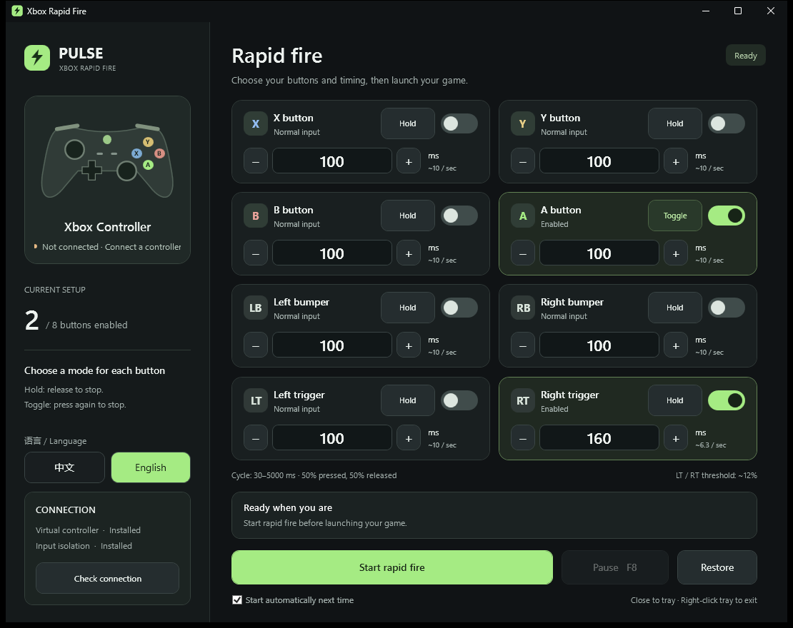

# PULSE · Xbox Rapid Fire

[中文](README.md) | **English**

A rapid-fire utility for Xbox / XInput controllers in **Windows PC games**. Configure each button independently with Hold or Toggle mode, custom timing, and instant Chinese / English language switching.

[Download the latest release](https://github.com/gosick233-cloud/xbox-rapid-fire/releases/latest)



## Features

- Independent settings for **X, Y, B, A, LB, RB, LT, and RT**.
- **Hold**: hold the controller button to repeat; release it to stop.
- **Toggle**: press once to start continuous rapid fire; press again to stop.
- **30–5000 ms** cycle, with equal pressed and released phases. A 100 ms cycle is approximately 10 presses per second.
- Mix modes across buttons while preserving normal stick, D-pad, and menu input.
- Instant **中文 / English** switching for the interface, messages, and tray menu.
- **F8** to pause / resume; saved button settings and language preference.
- Closing or minimizing keeps the app in the system tray. Exit from its tray menu to restore the controller.
- Dark interface, animated switches, and application / tray icons.

## Getting started

Requirements: Windows 10 / 11 **x64**, one Xbox / XInput controller, and [.NET 8 Desktop Runtime x64](https://dotnet.microsoft.com/download/dotnet/8.0).

1. Download `PULSE-XboxRapidFire-v1.2.0-win-x64.zip` from [Releases](https://github.com/gosick233-cloud/xbox-rapid-fire/releases/latest) and extract the entire folder.
2. Run `XboxRapidFire.exe`. On first use, select Install drivers and complete the official ViGEmBus and HidHide installers. Restart Windows if requested.
3. Connect one controller. Choose Hold or Toggle on each card, enable its switch, and set its cycle.
4. Click Start rapid fire **before launching your game**. If the game is already running, close and reopen it.
5. Select 中文 / English in the sidebar. The window's close button hides it to the tray; use Exit and restore controller in the tray menu to quit.

Pausing, disabling a button, changing its mode, or ending the session clears its toggle firing state. Editing the cycle preserves an active toggle. Toggle-mode triggers emit full-strength presses; Hold mode preserves the physical trigger strength.

Settings and logs are stored in `%LOCALAPPDATA%\XboxRapidFire`. The current version handles one physical controller at a time. Actual recognition speed depends on the game's input rules and frame rate.

## Technology

| Technology | Role |
| --- | --- |
| **C# / .NET 8** | Application logic, settings, rapid-fire processing, and background threads |
| **WPF / XAML** | Dark desktop interface, bindings, vector graphics, and switch animations |
| **Windows Forms NotifyIcon** | System tray icon and context menu |
| **Windows XInput 1.4** | Physical controller input and rumble forwarding |
| **ViGEmBus 1.22.0** | Virtual Xbox 360 controller output for games |
| **Nefarius.ViGEm.Client 1.21.256 / ViGEmClient** | Managed and native communication with the virtual controller driver |
| **HidHide 1.5.230** | Temporary physical-controller hiding to avoid duplicate input |
| **Win32 P/Invoke, SetupAPI, HID, Configuration Manager, IOCTL** | Native device enumeration, Unicode driver configuration, hotkeys, and window appearance |
| **Stopwatch / dedicated input thread** | Elapsed-time pulse phases, independent intervals, and toggle latches |
| **System.Text.Json / WPF DynamicResource** | Saved settings, embedded bilingual strings, and immediate language updates |

Input flow: physical controller → XInput → independent rapid-fire state machine → ViGEm virtual controller → game. HidHide routes game input to the virtual controller. Normal exit restores the session's changes; a recovery process handles unexpected exits.

## Build from source

Install the .NET 8 SDK, clone the repository, and run from its root:

```powershell
dotnet build src/XboxRapidFire.csproj -c Release
dotnet publish src/XboxRapidFire.csproj -c Release -r win-x64 --self-contained false -p:PublishSingleFile=true -o artifacts/publish
```

The required ViGEm .NET client assembly is included. Drivers are installed separately. To enable the app's installation button, place these official installers in `artifacts/publish/Drivers/`:

- [ViGEmBus 1.22.0](https://github.com/nefarius/ViGEmBus/releases/tag/v1.22.0): `ViGEmBus_1.22.0_x64_x86_arm64.exe`
- [HidHide 1.5.230](https://github.com/nefarius/HidHide/releases/tag/v1.5.230.0): `HidHide_1.5.230_x64.exe`

The application checks installer signatures before running them. The ViGEm projects are retired; see the upstream [end-of-life statement](https://docs.nefarius.at/projects/ViGEm/End-of-Life/).

```text
src/                    WPF application, engine, native interfaces, and tests
src/Assets/             Icons and bilingual strings
deps/vigem-client/      ViGEm .NET client assembly
docs/                   Screenshots and architecture notes
licenses/               Original third-party license texts
THIRD_PARTY_NOTICES.md   Upstream projects, authors, and acknowledgements
```

## Verification

Version 1.2.0 passed **38 logic tests and 39 UI checks**, covering both modes, independent intervals, language switching, error messages, tray menus, and minimum-size layouts. Actual game compatibility was not tested.

```powershell
artifacts/publish/XboxRapidFire.exe --self-test artifacts/logic-tests.json
artifacts/publish/XboxRapidFire.exe --ui-test artifacts/ui-tests
```

Exit the running application from its tray menu before running UI tests. See [ARCHITECTURE.md](docs/ARCHITECTURE.md) for internal design and optional driver integration checks.

## Acknowledgements

Thank you to **Benjamin Höglinger-Stelzer (nefarius)**, **Eric Korff de Gidts**, **Nefarius Software Solutions e.U.**, and the upstream contributors for their work on Windows controllers and input devices. This application's virtual controller and input isolation capabilities build on:

- [ViGEmBus](https://github.com/nefarius/ViGEmBus): virtual game controller bus driver.
- [ViGEm.NET](https://github.com/nefarius/ViGEm.NET) and [ViGEmClient](https://github.com/nefarius/ViGEmClient): managed and native client libraries.
- [HidHide](https://github.com/nefarius/HidHide): device hiding and application access control.
- [Microsoft .NET / WPF](https://github.com/dotnet/wpf): desktop framework and tooling.

We appreciate the original authors for making these technologies and their source available. Upstream components retain their original copyrights and licenses; see [THIRD_PARTY_NOTICES.md](THIRD_PARTY_NOTICES.md) and [licenses](licenses/).
