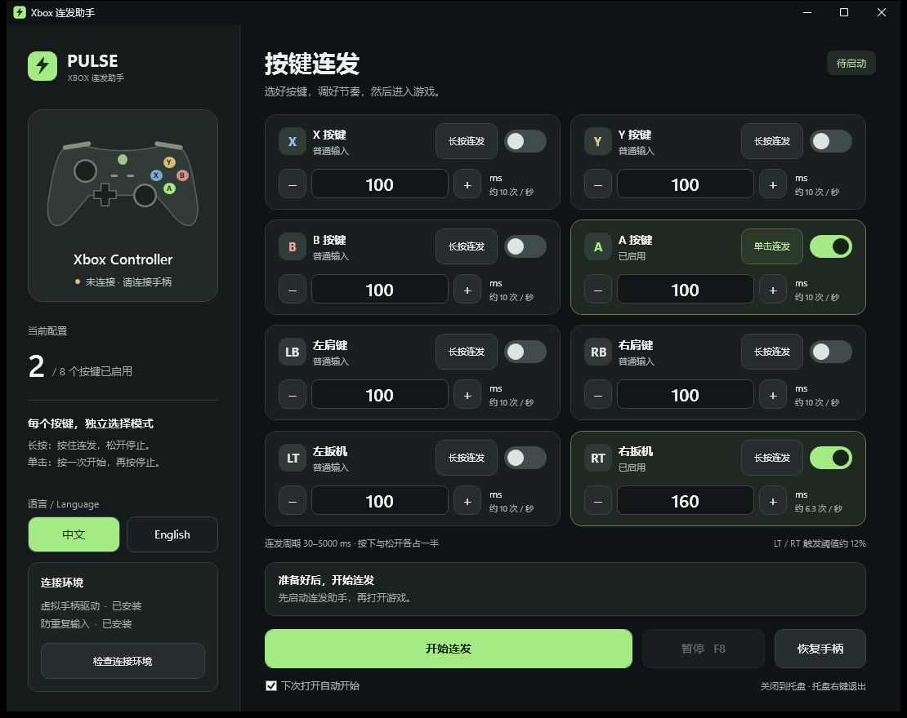

# PULSE · Xbox 连发助手

**中文** | [English](README.en.md)

一个用于 **Windows 电脑游戏**的 Xbox / XInput 手柄连发工具。支持每个按键独立选择长按连发或单击连发、自定义周期，以及中英文即时切换。

[下载最新版本](https://github.com/gosick233-cloud/xbox-rapid-fire/releases/latest)



## 功能

- 支持 **X、Y、B、A、LB、RB、LT、RT**，每个按键独立配置。
- **长按连发**：按住连发，松开停止。
- **单击连发**：按一次开始持续连发，再按一次停止。
- 连发周期 **30–5000 ms**，按下和松开各占一半；100 ms 约每秒 10 次。
- 两种模式可以混合使用，摇杆、方向键、菜单键等保持正常输入。
- **中文 / English** 即时切换，界面、提示和托盘菜单同步更新。
- **F8** 暂停 / 恢复；设置和语言选择自动保存。
- 关闭或最小化窗口后驻留托盘；通过托盘右键退出并恢复手柄。
- 深色界面、平滑开关动画、任务栏与托盘图标。

## 使用方法

运行环境：Windows 10 / 11 **x64**、一只 Xbox / XInput 手柄，以及 [.NET 8 Desktop Runtime x64](https://dotnet.microsoft.com/download/dotnet/8.0)。

1. 从 [Releases](https://github.com/gosick233-cloud/xbox-rapid-fire/releases/latest) 下载 `PULSE-XboxRapidFire-v1.2.0-win-x64.zip`，完整解压。
2. 运行 `XboxRapidFire.exe`。首次使用时点击“安装所需驱动”，完成 ViGEmBus 和 HidHide 官方安装向导；如果提示重启，请先重启。
3. 连接一只手柄，在每张卡片选择“长按连发”或“单击连发”，打开旁边的启用开关，设置周期。
4. 点击“开始连发”，**然后再启动游戏**。如果游戏已经打开，请退出游戏后重新启动。
5. 左侧“中文 / English”切换语言。右上角关闭按钮隐藏到托盘；托盘右键“退出并恢复手柄”才会退出。

暂停、关闭某个按键的启用开关、切换其模式或结束连发会清除对应的单击连发状态。调整周期会保留正在进行的单击连发。单击模式的扳机输出完整扣压；长按模式保留实际扣压幅度。

设置与日志保存在 `%LOCALAPPDATA%\XboxRapidFire`。当前版本一次处理一只实体手柄。实际连发识别速度取决于游戏的输入规则和帧率。

## 使用的技术

| 技术 | 在项目中的作用 |
| --- | --- |
| **C# / .NET 8** | 主程序、配置、连发逻辑与后台线程 |
| **WPF / XAML** | 深色桌面界面、数据绑定、矢量图形与开关动画 |
| **Windows Forms NotifyIcon** | 系统托盘图标与右键菜单 |
| **Windows XInput 1.4** | 读取实体手柄按键、扳机、摇杆与转发震动 |
| **ViGEmBus 1.22.0** | 创建供游戏读取的虚拟 Xbox 360 手柄 |
| **Nefarius.ViGEm.Client 1.21.256 / ViGEmClient** | .NET 与虚拟手柄驱动之间的通信 |
| **HidHide 1.5.230** | 临时隐藏实体手柄，避免游戏同时接收两份输入 |
| **Win32 P/Invoke、SetupAPI、HID、Configuration Manager、IOCTL** | 原生设备枚举、Unicode 驱动配置、全局快捷键与窗口外观 |
| **Stopwatch / 独立输入线程** | 根据经过时间计算每个按键的连发相位，支持独立周期和单击锁定 |
| **System.Text.Json / WPF DynamicResource** | 配置持久化、内嵌中英文文本与即时语言切换 |

输入流程：实体手柄 → XInput → 独立连发状态机 → ViGEm 虚拟手柄 → 游戏。HidHide 让游戏接收虚拟手柄输入；正常退出时恢复本次更改，异常退出由恢复进程处理。

## 从源码构建

安装 .NET 8 SDK，克隆本仓库后在根目录运行：

```powershell
dotnet build src/XboxRapidFire.csproj -c Release
dotnet publish src/XboxRapidFire.csproj -c Release -r win-x64 --self-contained false -p:PublishSingleFile=true -o artifacts/publish
```

仓库包含所需的 ViGEm .NET 客户端程序集。驱动由用户安装；若要使用程序内安装按钮，将以下官方安装包放入 `artifacts/publish/Drivers/`：

- [ViGEmBus 1.22.0](https://github.com/nefarius/ViGEmBus/releases/tag/v1.22.0)：`ViGEmBus_1.22.0_x64_x86_arm64.exe`
- [HidHide 1.5.230](https://github.com/nefarius/HidHide/releases/tag/v1.5.230.0)：`HidHide_1.5.230_x64.exe`

程序在执行安装包前检查其数字签名。ViGEm 系列已停止维护，详情见[上游生命周期说明](https://docs.nefarius.at/projects/ViGEm/End-of-Life/)。

```text
src/                    WPF 程序、连发引擎、原生设备接口与测试
src/Assets/             图标与中英文文本
deps/vigem-client/      ViGEm .NET 客户端程序集
docs/                   界面截图与架构说明
licenses/               第三方许可证原文
THIRD_PARTY_NOTICES.md   上游项目、作者与致谢
```

## 验证

1.2.0 版已通过 **38 项逻辑测试、39 项界面检查**。检查包含两种连发模式、独立周期、语言切换、错误提示、托盘菜单及最小窗口布局；未进行实际游戏兼容性测试。

```powershell
artifacts/publish/XboxRapidFire.exe --self-test artifacts/logic-tests.json
artifacts/publish/XboxRapidFire.exe --ui-test artifacts/ui-tests
```

运行界面测试前，请先通过托盘菜单退出正在运行的程序。更多架构与可选驱动测试命令见 [ARCHITECTURE.md](docs/ARCHITECTURE.md)。

## 致谢

感谢 **Benjamin Höglinger-Stelzer（nefarius）**、**Eric Korff de Gidts**、**Nefarius Software Solutions e.U.** 以及上游贡献者在 Windows 手柄与输入设备领域的工作。本项目的虚拟手柄和输入隔离功能建立在这些项目提供的能力之上：

- [ViGEmBus](https://github.com/nefarius/ViGEmBus)：虚拟游戏手柄总线驱动。
- [ViGEm.NET](https://github.com/nefarius/ViGEm.NET) 与 [ViGEmClient](https://github.com/nefarius/ViGEmClient)：.NET 与原生客户端库。
- [HidHide](https://github.com/nefarius/HidHide)：输入设备隐藏与应用访问控制。
- [Microsoft .NET / WPF](https://github.com/dotnet/wpf)：桌面应用框架与工具链。

感谢原作者公开这些技术与源码。项目使用到的上游组件保留原有版权与许可证，详见 [THIRD_PARTY_NOTICES.md](THIRD_PARTY_NOTICES.md) 和 [licenses](licenses/)。
